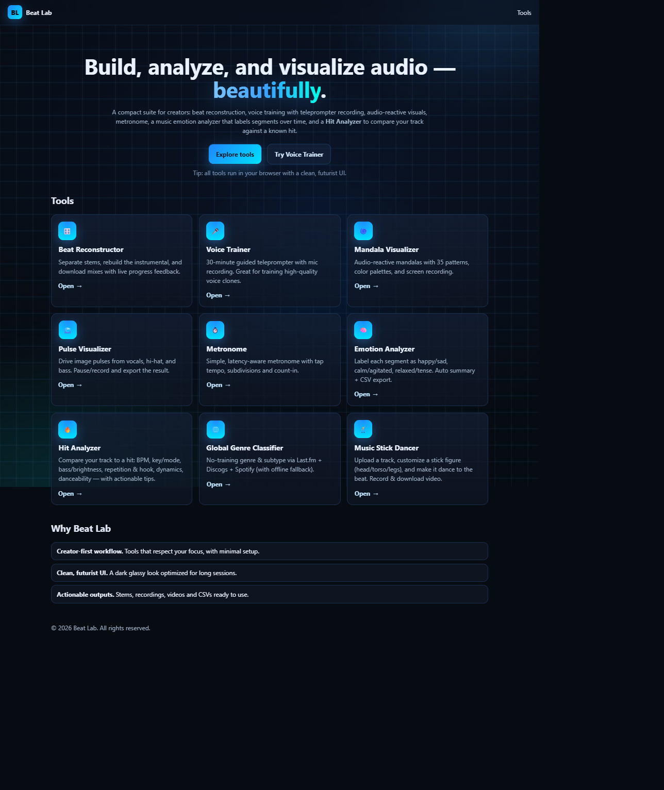
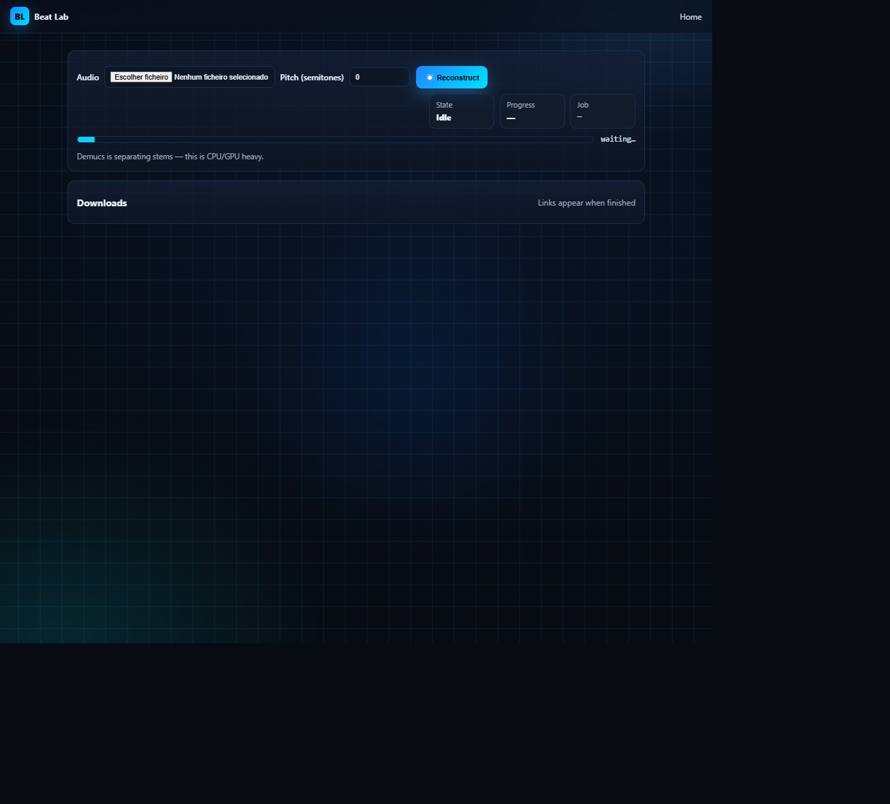
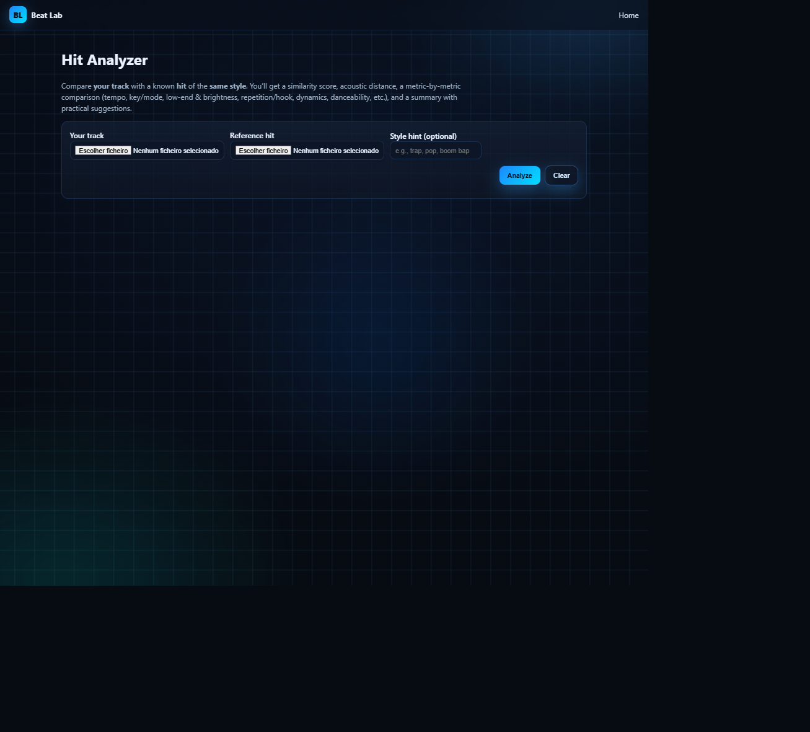
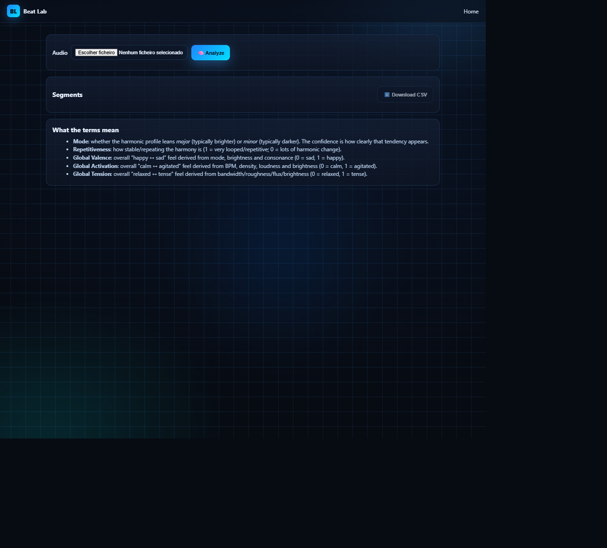
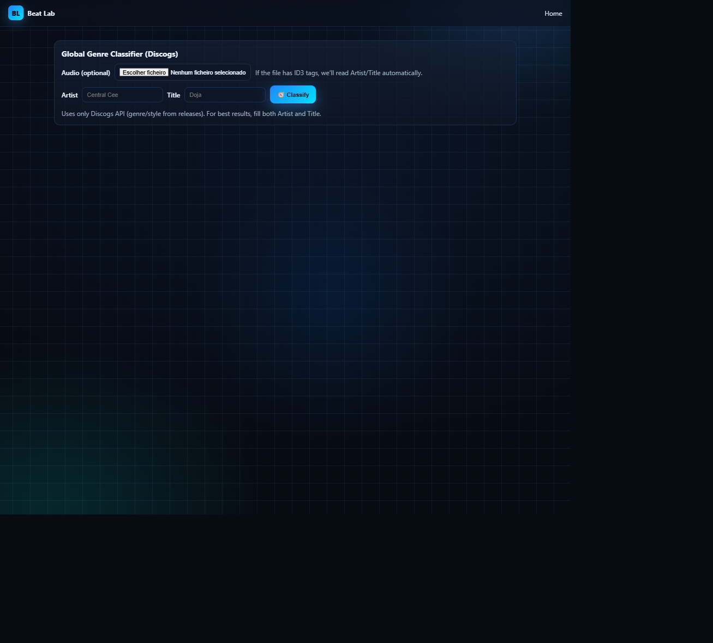
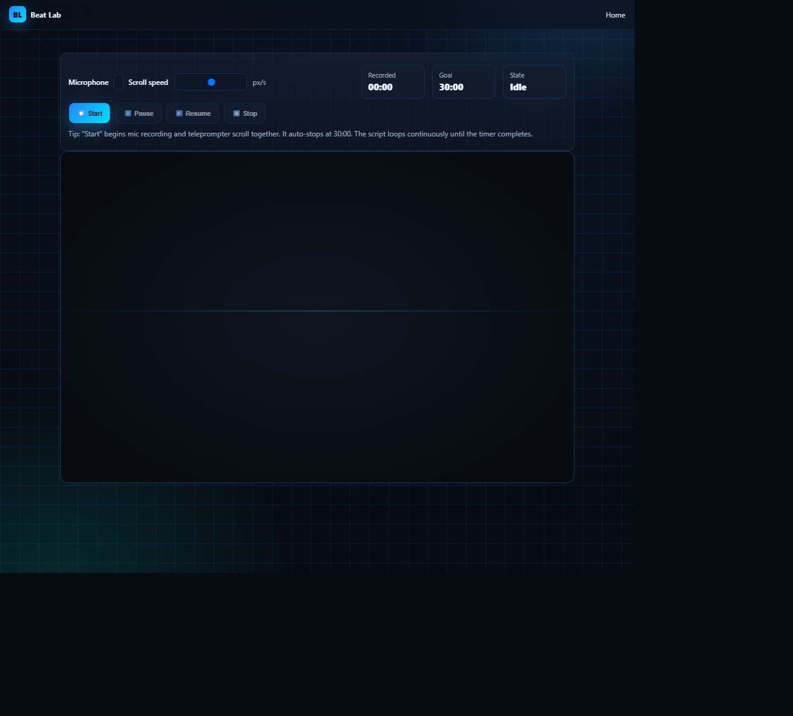
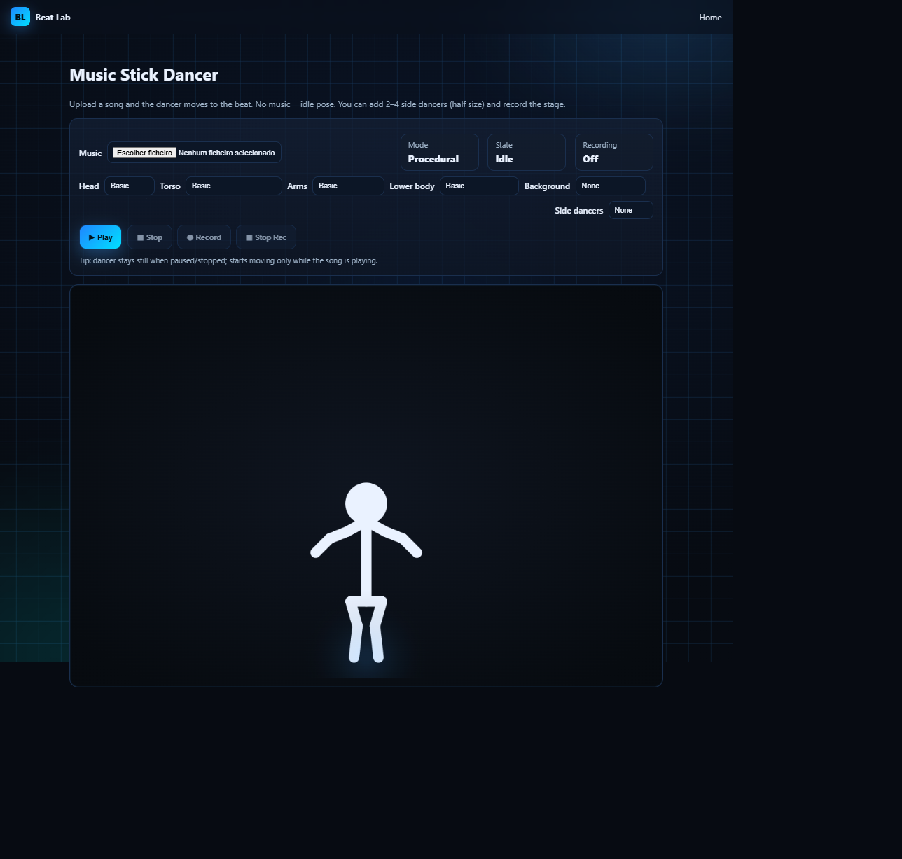
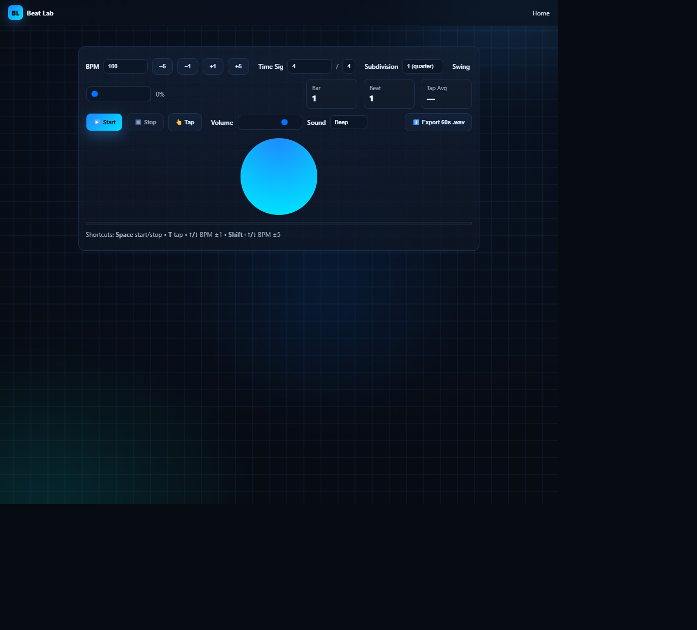
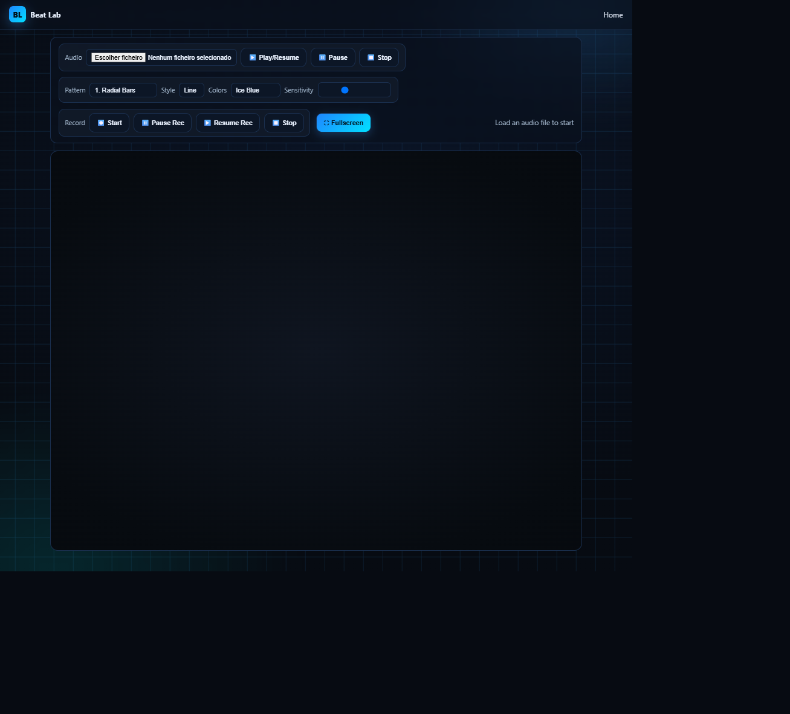
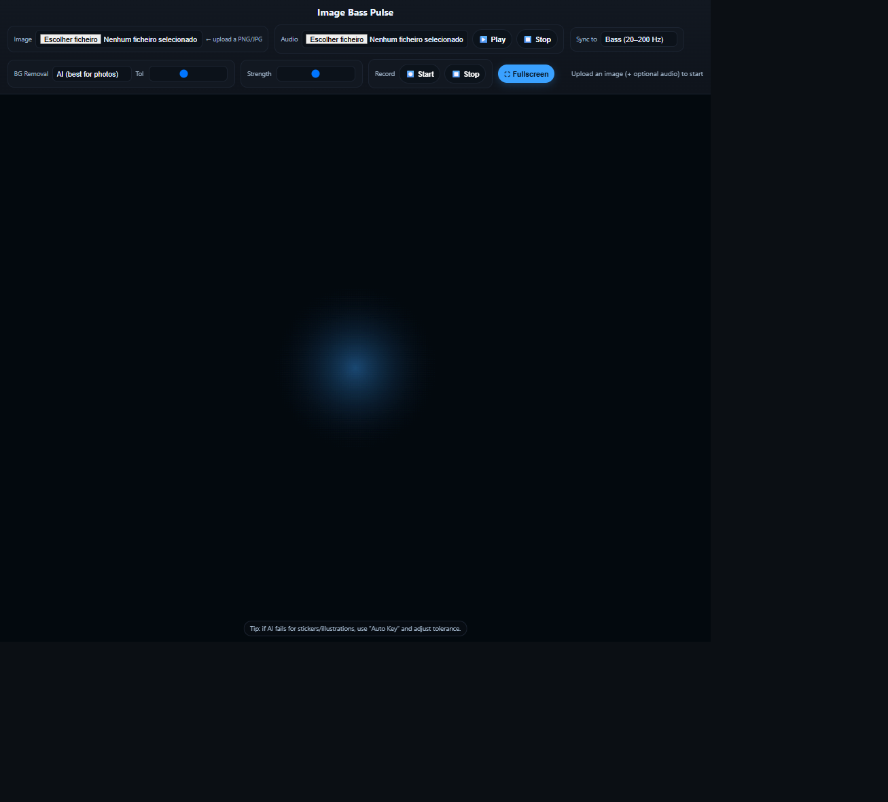

# Beat Lab — Audio Tools & Karaoke Experiments

**Exploring practical audio processing, music analysis, synchronized lyrics, and interactive web tools through AI-assisted product development.**

**[See the interface](#interface-preview)** · **[Explore the tools](#tools--experiments)** · **[Screenshot gallery](#screenshots--demonstrations)** · **[Karaoke Pro Editor](#karaoke-generator--pro-editor)** · **[How I work](#my-role--workflow)**

> **Public portfolio showcase.** This repository presents selected features, design decisions, and testing experience from Beat Lab. The original application source, dependencies, local files, model assets, and infrastructure are **not included** here. This is a development/portfolio project, not a claim of a production-ready hosted service.

---

## Interface preview

  

<em>Original screenshot of the locally running Beat Lab home page. Click to view the complete image.</em>

## Overview

**Beat Lab** (the original project is also known as *Beat Reconstructor MIDI*) is an experimental collection of web-based music and audio tools. It combines audio-processing pipelines, analysis interfaces, interactive visualizations, and a separately preserved Karaoke Generator prototype.

I approach the project as a product builder using **AI-assisted development**, with an emphasis on turning ideas into practical workflows, testing results, troubleshooting problems, and iterating on user experience.

### Project at a glance

| Area | What the project explores |
| --- | --- |
| **Audio separation** | Separating vocal and instrumental components and experimenting with instrumental reconstruction and pitch adjustments |
| **Music analysis** | Comparing tracks and exploring music characteristics, emotion, and genre classification |
| **Karaoke editing** | Aligning lyrics to audio and visually editing word-level timing through a Pro Editor |
| **Browser tools** | Audio-reactive visualizations, metronome, voice practice, and other experiments |
| **Engineering workflow** | Python APIs, JavaScript interfaces, debugging, testing, and local deployment |

## Tools & experiments

These descriptions reflect features or implementation paths found in the **private source repository**. They do not imply that each tool has passed independent end-to-end verification.

| Tool | Purpose | Status represented here |
| --- | --- | --- |
| **Beat Reconstructor** | Upload audio, run Demucs stem separation, explore pitch-shifting and instrumental outputs, and track processing jobs. | API and processing code present; runtime not independently verified for this showcase |
| **Hit Analyzer** | Compare audio characteristics of a track with a reference and present a comparison summary. | API and UI code present |
| **Emotion Analyzer** | Explore audio characteristics across song segments through an analysis interface. | API and UI code present |
| **Global Genre Classifier** | Experiment with genre/subgenre analysis and a dedicated browser interface. | Analysis code and UI present |
| **Voice Trainer** | Practice and recording interface for vocal exercises in the browser. | UI prototype present |
| **Interactive visuals** | Audio-reactive experiments including Mandala, Pulse, and Stick Dancer. | UI experiments present |
| **Metronome** | Browser-based timing and rhythm practice interface. | UI present |
| **MIDI utilities** | Supporting experiments for MIDI-related processing. | Helper module present; integration not verified |
| **Background removal** | An API experiment for image background removal. | Endpoint present; runtime/dependencies not independently verified |
| **Karaoke Generator + Pro Editor** | Audio-to-lyrics alignment, synchronized rendering, editable timing, and subtitle export. | **Separate prototype snapshot; not integrated into the default main app** |

## Karaoke Generator & Pro Editor

This is one of the most detailed experimental workflows in the project. The preserved prototype includes:

1. **Audio and lyrics input:** MP3, WAV, or M4A with a backend duration limit of five minutes.
2. **Audio preprocessing:** FFmpeg conversion and Demucs processing to isolate vocals for lyric alignment.
3. **Lyric alignment:** Montreal Forced Aligner (MFA) and TextGrid-based timing extraction, dependent on local language models.
4. **Synchronized display:** A karaoke stage that visually follows lyric timing during playback.
5. **Pro Editor:** An editable, track-wide timeline with zoom controls and tools for adjusting word and line timing.
6. **Subtitle export:** SRT and LRC output for further use in other media workflows.

The prototype includes language-handling logic for **English and Portuguese**, subject to installed models and local configuration.

**Integration status matters:** the Karaoke implementation is stored as a separate snapshot in the private repository. It has **not been verified as part of the default main application**. The features above describe prototype code, not a deployed public karaoke service.

## Technologies I've worked with

| Area | Tools and concepts |
| --- | --- |
| **Backend** | Python, FastAPI, Uvicorn, API endpoints, asynchronous/background processing |
| **Audio** | FFmpeg, Demucs, Librosa, PyTorch, NumPy, SoundFile |
| **Karaoke prototype** | Montreal Forced Aligner, TextGrid, timing extraction, subtitle generation |
| **Frontend** | HTML, CSS, JavaScript, browser audio interfaces |
| **Other experiments** | MIDI processing helpers, visual effects, multimedia utilities |
| **Workflow** | Git, GitHub, Windows development, debugging, iterative QA and documentation |

*This reflects hands-on project exposure and AI-assisted implementation, not independent expert-level proficiency in every technology listed.*

## My role & workflow

I use AI tools to help implement ideas, but the project work also involves decisions and verification that cannot be reduced to generating code.

- **Product definition:** Specify what a tool should do, its input/output flow, and expected behavior.
- **UX iteration:** Review interfaces and improve controls, layouts, playback interactions, and editor usability.
- **Manual QA:** Run practical tests, reproduce bugs, describe expected versus actual results, and check regressions.
- **Troubleshooting:** Investigate errors involving dependencies, audio processing, timing, local environments, and integration.
- **Workflow design:** Break complex ideas into smaller, testable milestones and review changes before progressing.
- **Documentation:** Explain prototypes, limitations, operating assumptions, and next steps clearly.

**Transparency:** AI coding assistance is a substantial part of this workflow. I do not present myself as the independent author of every technical implementation or as a specialist in all underlying audio algorithms.

## Product and QA lessons

**Audio is a pipeline, not just a button.** Upload validation, media conversion, processing time, model dependencies, and useful feedback can all affect the user experience.

**Synchronization must be tested by listening and watching.** Accurate-looking timing data is not enough without human playback checks, seeking, pause/resume, and timeline editing.

**Prototypes and integrated releases are different things.** A feature can be well developed in a separate source snapshot without being available in the default running application.

**Clear status reporting builds trust.** This showcase separates implemented code paths from verified demos and future work.

## Screenshots & demonstrations

These **10 original screenshots** come from the Beat Lab interface running locally in a web browser. The homepage is shown above; the gallery below covers nine distinct tool interfaces.

**What they demonstrate:** interface design, navigation, available inputs and controls, and the breadth of the tool collection.

**What they do not demonstrate:** end-to-end successful processing, tested audio outputs, a hosted service, or production readiness. Most screenshots show each tool's initial or idle state, before media has been uploaded.

### Audio processing & analysis

| Beat Reconstructor | Hit Analyzer |
| :---: | :---: |
|  |  |
| **Emotion Analyzer** | **Global Genre Classifier** |
|  |  |

### Recording, music practice & interaction

| Voice Trainer | Music Stick Dancer |
| :---: | :---: |
|  |  |
| **Metronome** | |
|  | **Interactive rhythm and timing practice** |

### Audio-reactive visual experiments

| Mandala Visualizer | Pulse Visualizer |
| :---: | :---: |
|  |  |

*Click any screenshot to see its original, full-resolution version.*

**Karaoke Generator and Pro Editor:** their implementation lives in a separate prototype snapshot and is **not shown in this gallery**. Screenshots can be added later if the separate prototype is run and reviewed.

**Availability:** Beat Lab is currently presented as a locally run development project; this repository does not link to a public hosted demo.

## What I'm interested in

I'm interested in **fully remote opportunities** where problem-solving, clear communication, product understanding, and practical testing are valued:

**Technical Support · Product Support · Customer Support · Manual QA · AI-Assisted Product Operations**

[**View my GitHub profile**](https://github.com/caiovitor2006-gif) · [**Explore PlayLobby Showcase**](https://github.com/caiovitor2006-gif/PlayLobby-Showcase)

---

### Repository scope & confidentiality

This is a **documentation-only public showcase**, not an open-source release. Beat Lab source code remains in the private repository, and no proprietary application files, model weights, media samples, credentials, or local infrastructure configuration are distributed here. Public screenshots and demos will be reviewed separately before publication.
